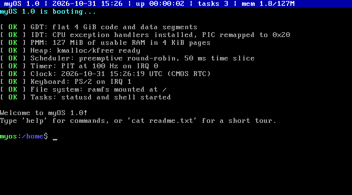
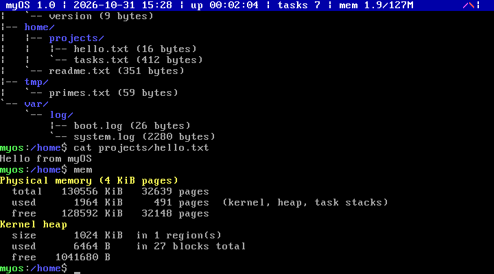
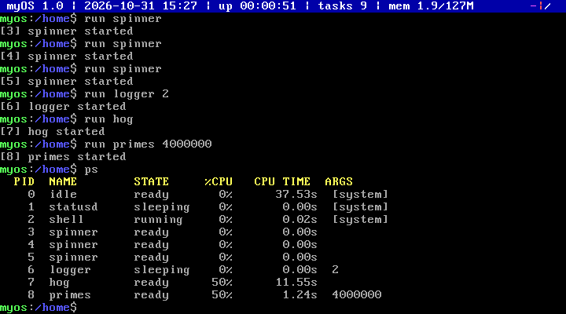

# myOS

A small operating system for x86 PCs, written from scratch in C and assembly.

myOS boots on its own, without Linux or Windows underneath. It has the basic parts every operating system needs: memory management, multitasking, a file system, drivers for the screen and keyboard, and a command-line shell. Everything is kept simple, so the whole system fits in about 3,600 lines of code.



## About this project

This is a learning project. I built myOS to understand how an operating system works from the inside: what happens when the computer boots, how the kernel reacts to the keyboard and the timer, how memory is handed out, how several programs share one CPU, and how files are organized.

The project was developed with the help of [Claude](https://claude.ai), an AI assistant by Anthropic, which helped design the architecture, write and debug the code, test it in QEMU, and write this documentation.

Since it was a study project, I kept it and worked on it only on my own machine for a while. It was published here in a single commit, so the repository has no earlier history.

## Quick start

On Debian or Ubuntu, install the tools:

```sh
sudo apt install build-essential gcc-multilib nasm qemu-system-x86 grub-pc-bin grub-common xorriso mtools
```

Then build and run:

```sh
make run        # build and start myOS in the QEMU emulator
make iso        # create a bootable ISO image (build/myos.iso)
make run-iso    # start the ISO in QEMU, booting through GRUB
make clean      # delete the build output
```

Once it boots, type `help` to see the commands, or `cat readme.txt` for a short tour.

## What you can do

**Work with files**

```text
myos:/home$ mkdir notes
myos:/home$ echo "remember the milk" > notes/todo.txt
myos:/home$ cat notes/todo.txt
remember the milk
myos:/home$ tree /
```



**Run programs at the same time**

```text
myos:/home$ run spinner        # an animation on the status bar
myos:/home$ run logger 2       # writes system stats to a file every 2 seconds
myos:/home$ run hog            # an infinite loop: the system keeps working
myos:/home$ ps                 # list running tasks and their CPU usage
myos:/home$ kill 5             # stop a task by its number (PID)
```

**See a crash handled safely**

```text
myos:/home$ run crash
crash: dividing by zero...
[kernel] task 6 (crash) killed: Divide by zero at eip=0x00100a81
```

Only the faulty program is stopped; the rest of the system keeps running.



### All commands

| Group | Commands |
|---|---|
| System | `help` `about` `echo` `clear` `color` `history` `date` `uptime` `mem` `reboot` `halt` |
| Processes | `ps` `run` `kill` `sleep` |
| Files | `pwd` `cd` `ls` `tree` `mkdir` `touch` `cat` `write` `rm` `cp` `mv` `stat` `df` |

Any command's output can be saved to a file with `>` (replace) or `>>` (append). The arrow keys bring back previous commands.

### Built-in programs

| Program | What it shows |
|---|---|
| `primes [limit]` | Heavy CPU work; the shell stays responsive while it runs |
| `hog` | An infinite loop cannot freeze the system |
| `logger [seconds]` | Several tasks using the file system at once (`/var/log/system.log`) |
| `spinner` | Many tasks running in parallel |
| `crash` | A crashing program is stopped without taking the system down |

## How it works

Each part of the system in a few words:

| Part | What it does | Code |
|---|---|---|
| **Boot** | GRUB loads the kernel into memory and starts it. The kernel then turns on each part below, in order. | `boot/`, `kernel/kernel.c` |
| **Interrupts** | The keyboard, the timer and CPU errors interrupt the kernel. Each interrupt goes through one entry point that saves the CPU state and calls the right handler. | `kernel/arch/` |
| **Memory** | RAM is split into 4 KiB pages, tracked in a bitmap (one bit per page: free or used). On top of that, a heap hands out small blocks of memory (`kmalloc` and `kfree`). | `kernel/mm/` |
| **Multitasking** | Programs run as tasks. The timer interrupts 100 times per second, and every 50 ms the scheduler pauses the current task and resumes the next one in line (round-robin). Tasks can sleep or wait for a key without using the CPU. | `kernel/proc/` |
| **File system** | Files and folders live in RAM as a tree, so they are lost on shutdown. Programs use a small set of functions (`fs_read`, `fs_write`, `fs_mkdir`...) that hide how the data is stored. | `kernel/fs/` |
| **Drivers** | Text-mode screen, keyboard, timer, real-time clock (date and time) and serial port (a log that shows up in the terminal when running in QEMU). | `kernel/drivers/` |
| **Shell** | Reads a line from the keyboard, splits it into words, and runs the matching command. | `kernel/shell/` |

### How tasks take turns

Every task has its own stack. When an interrupt arrives, all CPU registers of the current task are saved on its stack. If it is time to switch, the scheduler picks another task and the interrupt returns into that task's saved registers instead. From the task's point of view, it simply continues where it stopped.

## Limitations

These are deliberate, to keep the code small and easy to follow:

- All tasks run with full privileges and share the same memory. There is no user mode and no memory protection between programs.
- Files are stored in RAM and disappear when the machine is turned off.
- Programs are built into the kernel; myOS cannot load executables from files.
- Only one CPU core is used, and only the US keyboard layout is supported.

Possible next steps: virtual memory (paging), user mode with system calls, loading programs from files, and pipes (`cmd1 | cmd2`).

## Minimum requirements

myOS has been tested in QEMU and in virtual machines.

| | Requirement |
|---|---|
| CPU | 32-bit x86, i686 (Pentium Pro) or newer; any current x86-64 CPU works |
| RAM | 3 MiB |
| Firmware | BIOS, or UEFI with legacy/CSM boot enabled |
| Keyboard | PS/2, or USB with "USB legacy support" enabled in the BIOS |

## License

This project is licensed under the [MIT License](LICENSE).
